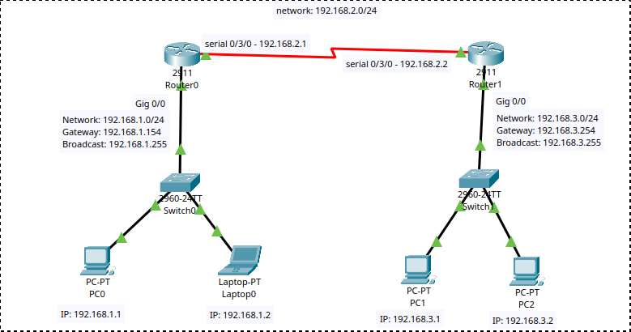

# Connecting Two LANs

A Cisco Packet Tracer lab connecting two LANs using two routers, using EIGRP for dynamic routing.

- **LAN 1:** `192.168.1.0/24`
- **LAN 2:** `192.168.3.0/24`
- **Inter-router network:** `192.168.2.0/24`.
- **Objective:** Enable communication between devices on both LANs using EIGRP.

Open `two-lan-connection-eigrp.pkt` in Cisco Packet Tracer to explore the topology and configuration.

## Network Diagram

