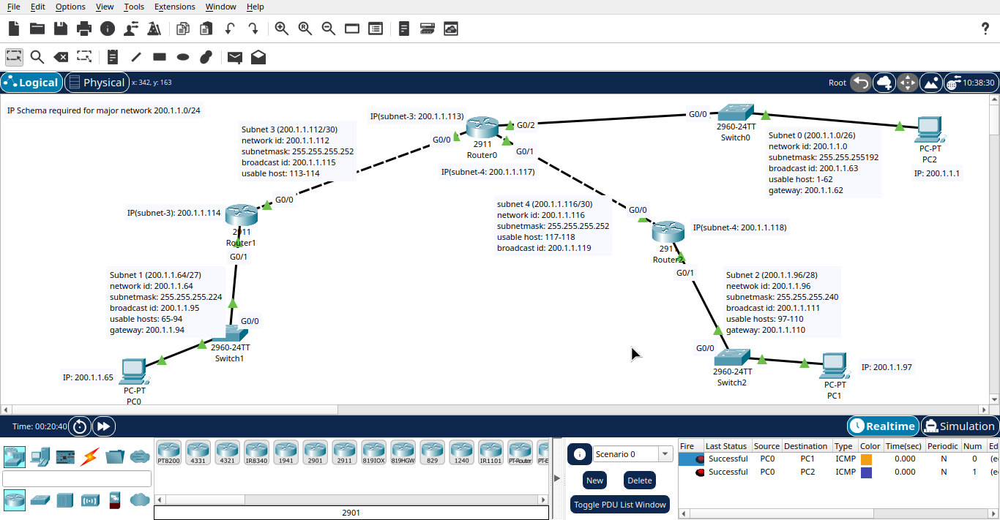

# IPv4 Subnetting and Network Design

A Cisco Packet Tracer lab demonstrating VLSM subnetting and connectivity between multiple networks using routers.

- **Major network:** `200.1.1.0/24`
- **Technique:** Variable Length Subnet Masking (VLSM)
- **Topology:** Three routers connecting multiple **LANs** and point-to-point links.
- **Objective:** Practise IP address allocation, subnet design, and connectivity between subnets.

## Subnet Allocation

| Subnet | Network |
|---|---|
| Subnet 0 | `200.1.1.0/26` |
| Subnet 1 | `200.1.1.64/27` |
| Subnet 2 | `200.1.1.96/28` |
| Subnet 3 | `200.1.1.112/30` |
| Subnet 4 | `200.1.1.116/30` |

## Network Diagram

