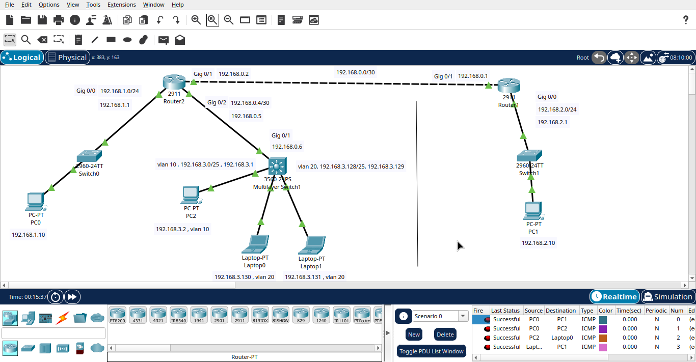

# VLAN Configuration, Layer 3 Switching and Static Routing

A Cisco Packet Tracer lab combining VLAN segmentation, inter-VLAN routing using a multilayer switch, and static routing between routers.

## Network Segments

| Network | Purpose |
|---|---|
| `192.168.1.0/24` | LAN connected to Router2 |
| `192.168.2.0/24` | LAN connected to Router1 |
| `192.168.0.0/30` | Router-to-router link |
| `192.168.0.4/30` | Router-to-multilayer-switch link |
| `192.168.3.0/25` | VLAN 10 |
| `192.168.3.128/25` | VLAN 20 |

## Static Routing

| Device | Destination network | Next hop |
|---|---|---|
| Router1 | `192.168.3.0/24` | `192.168.0.6` |
| Router1 | `192.168.2.0/24` | `192.168.0.1` |
| Router2 | `192.168.3.0/24` | `192.168.0.2` |
| Router2 | `192.168.1.0/24` | `192.168.0.2` |
| Layer 3 switch | `0.0.0.0/0` (default route) | `192.168.0.5` |

## Objective

Configure VLANs, enable inter-VLAN routing on a multilayer switch, and use static routing to connect separate networks.

## Network Diagram

